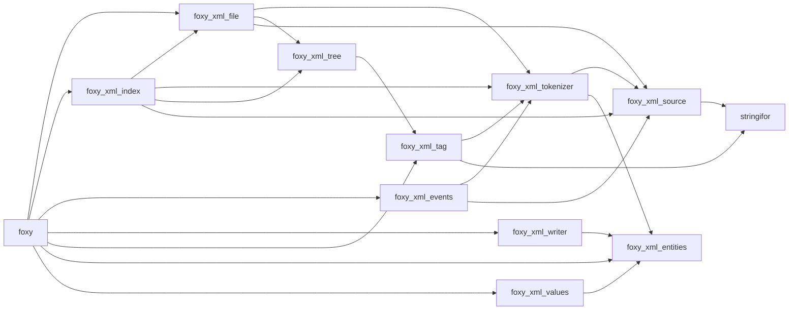

# Features

## One module

Everything comes from the `foxy` module: the five types, the kinds, the error codes and a few helpers.

```fortran
use foxy                       ! xml_file, xml_index, xml_handler (with xml_attribute), xml_writer, xml_tag;
                               ! I1P...I8P, R4P, R8P; XML_MALFORMED, XML_NOT_FOUND, XML_BAD_VALUE;
                               ! xml_escape, xml_unescape, to_value, to_values; regex, regex_match (StringiFor)
type(xml_file) :: doc

call doc%parse(filename='case.xml')
print '(A)', doc%content('dt')
```

## Feature map

| Area | Features | Where |
|---|---|---|
| **Parsing** | strings and files (read in chunks, larger than 2 GiB); one tokenizer for everything; tolerant: the first problem reported with its line (`XML_MALFORMED`), the document built anyway; prolog, comments, PIs and CDATA kept | [Parsing](./parsing) |
| **Querying** | tags by name, path or parent; children, parent, level; attributes by name or listed; text with references decoded, CDATA literal, mixed content | [Querying](./querying) |
| **Typed values** | contents and attributes as integers (`I1P`…`I8P`), reals (`R4P`, `R8P`), logicals or lists; `XML_NOT_FOUND`, `XML_BAD_VALUE` | [Typed values](./values) |
| **Editing** | build in code (`add_tag`); edit by ID: content (text or numbers), attributes, names, insertion before or after a sibling, deletion; `stringify`, `save` | [Editing](./editing) |
| **Writing** | `xml_writer`: streaming to a file, a unit or memory; layout, escaping, numbers and lists, binary blocks; only well-formed XML (names, attributes, text, one root element) | [Writing](./writing) |
| **Large files** | `xml_index`: tags without content, contents on demand, byte ranges, scan stopped before raw data | [The index](./index-files) |
| **Streaming** | `xml_handler`: your callbacks for each element, text and problem, in one pass over a source of any size; decoded text, balanced elements, `stop_parsing` | [Streaming parser](./events) |
| **Namespaces** | prefix, local name, namespace of each tag; queries by `{uri}local` or with your own prefixes | [Namespaces](./namespaces) |
| **Regular expressions** | filter tags by name, content or attribute value with a compiled regex (StringiFor engine: Python `re` syntax without backreferences or lookaround), chained with any query | [Regular expressions](./regex) |
| **Path selector** | `select('//event[@type="x"]/origin[1]')`: children, descendants, any name, attribute and regex predicates, positions; a malformed expression reported with its column | [Querying](./querying#path-selector) |
| **Encodings** | UTF-8, UTF-16, UTF-32, ISO-8859-1, windows-1252 and US-ASCII sources read (converted to UTF-8 as they are read, StringiFor engine); other encodings reported; output always UTF-8 | [Parsing](./parsing#encodings) |
| **Single tags** | `xml_tag`: create, parse, add and delete attributes, write a start tag, content or end tag | [Single tags](./tags) |
| **Every method** | the arguments of each type-bound procedure, in tables | [Methods summary](./api-reference) |

## Design

- **Pure Fortran 2008**, no C bindings. The tokenizer, the lookups (`find`, `find_all`, `matching`) and the edits are
  `pure`; `select` (it compiles regexes), the typed getters and the I/O are not.
- **One parser**: documents, files in chunks, the index, the streaming parser, single tags and attribute streams go
  through the same single-pass tokenizer, so they all accept, and report, the same things.
- **A flat DOM**: an `xml_file` is an array of tags in document order, linked by IDs; no pointers, nothing to free by
  hand.
- **Faithful**: tags, attributes, text, CDATA, comments and PIs are kept as read, so `stringify` writes an equivalent
  document; start tags are rewritten (double quotes, one space between attributes), element-only content is laid out
  again, the spaces around the text of a leaf tag are dropped. The accessors decode the stored text.
- **Linear**: parsing and writing are O(n); `find(parent=)` and path segments walk the children lists; sources over
  2 GiB are fine (64-bit positions).

## Modules



| Module | Holds |
|---|---|
| `foxy` | the public names (use only this one) |
| `foxy_xml_file` | `xml_file`, the DOM |
| `foxy_xml_index` | `xml_index`, the index of a file |
| `foxy_xml_events` | `xml_handler`, the streaming parser |
| `foxy_xml_writer` | `xml_writer`, the streaming writer |
| `foxy_xml_tag` | `xml_tag`, a single element |
| `foxy_xml_source` | the encoding of a source: detection, conversion to UTF-8 |
| `foxy_xml_tokenizer` | the tokenizer, fed in pieces, driving a builder |
| `foxy_xml_tree` | the queries shared by the DOM and the index |
| `foxy_xml_values` | the conversion of text to numbers and logicals |
| `foxy_xml_entities` | character references, escaping, XML names |

## Compiler support

| Compiler | Status |
|---|---|
| GNU gfortran 14, 16 | tested (CI: gfortran 14) |
| Intel ifx 2025.3 | tested (build with `-heap-arrays`) |
| NVIDIA nvfortran 26.5, 26.9 | tested (build with `-D_NVF`) |

## Limits

- Entities defined by a DTD (e.g. `&nbsp;`) are not expanded: only the predefined and the numeric references are.
- Undeclared namespace prefixes are not reported (their namespace is `''`).
- Encodings other than UTF-8, UTF-16, UTF-32, ISO-8859-1, windows-1252 and US-ASCII are reported, then read as UTF-8;
  `xml_index` refuses UTF-16 and UTF-32 files (its positions are file bytes).
- XPath only as the subset of `select` (`/`, `//`, `*`, `[@k]`, `[@k="v"]`, `[@k~="re"]`, `[n]`): no axes, no
  functions, no boolean operators.
- Regular expressions without backreferences or lookaround (StringiFor's engine, linear time).

Next: [Parsing](./parsing).
