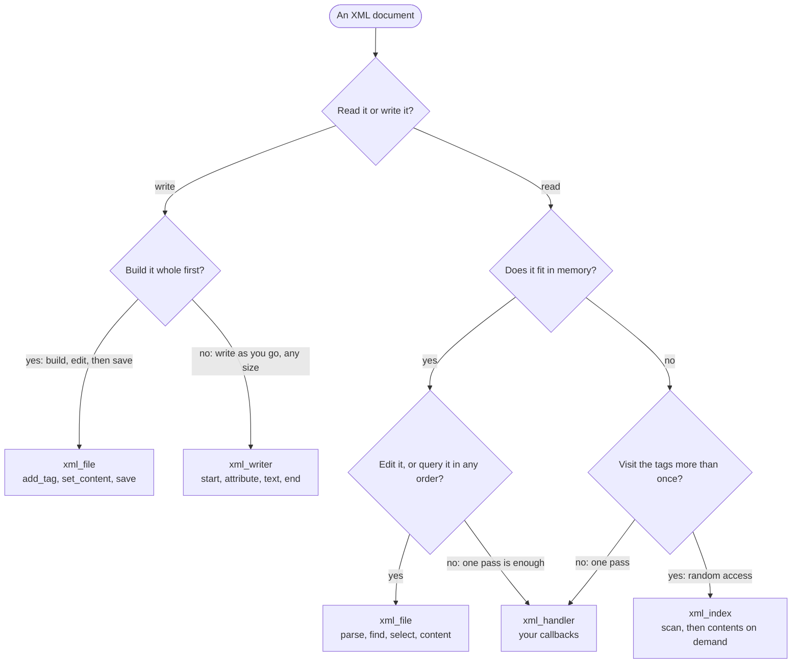

# About FoXy

FoXy (Fortran XML for poor people) is a pure Fortran library to read, edit and write XML. Five types cover every use:

| Type | For |
|---|---|
| `xml_file` | a whole document in memory (a DOM): parse a string or a file, query it, edit it, save it |
| `xml_index` | a file too large to hold: its tags and attributes, the contents read on demand |
| `xml_handler` | a document of any size read once, in order: your callbacks are called for each tag and text, nothing is stored |
| `xml_writer` | a document of any size, written element by element to a file, a unit or memory |
| `xml_tag` | a single element: build it, parse it, write it |

Which one you need depends on what you do with the document:

The library targets scientific codes: case files, results metadata (VTK, XDMF), catalogues (QuakeML). It is standard
Fortran 2008, with no C bindings; it depends on small libraries by the same author (PENF for the kinds, StringiFor for
strings, BeFoR64 and FACE), which every build system fetches.

This documentation reads in order, and each page links to the next one:

1. [Installation](./installation): get FoXy into your project.
2. The [tutorial](/manual/): nine short chapters that build the input and output of a solver, step by step.
3. The [cookbook](/manual/cookbook): short recipes, one for each "how do I ...?".
4. The reference, from the [feature map](./features#feature-map) on: every method, every argument.

The [API](/api/) documents the source itself. Every code sample of the tutorial, of the cookbook and of the reference is
part of a program that is compiled and run to produce the outputs shown (see
[`docs/examples`](https://github.com/Fortran-FOSS-Programmers/FoXy/tree/master/docs/examples)).

## Authors

- Stefano Zaghi — [@szaghi](https://github.com/szaghi)
- Fortran FOSS Programmers — [github.com/Fortran-FOSS-Programmers](https://github.com/Fortran-FOSS-Programmers)

Contributions are welcome — see the [Contributing](./contributing) page.

## Copyrights

FoXy is distributed under a multi-licensing system:

- for FOSS projects: [GPL v3](http://www.gnu.org/licenses/gpl-3.0.html);
- for closed-source or commercial projects: [BSD 2-Clause](http://opensource.org/licenses/BSD-2-Clause),
  [BSD 3-Clause](http://opensource.org/licenses/BSD-3-Clause) or [MIT](http://opensource.org/licenses/MIT).

Next: [Installation](./installation).
