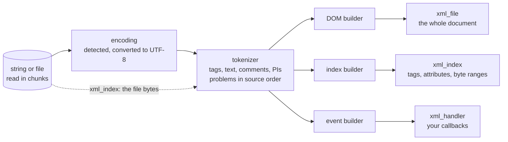

# Parsing

There is one parser: every reader of FoXy (the DOM, the index, the streaming parser, single tags and attribute streams)
feeds the same tokenizer and differs only in what it keeps of the tokens.

## Strings and files

<<< @/examples/snippets/solver_2-parse.f90

`parse(string=)` or `parse(filename=)` replaces the content of an `xml_file` with the parsed document.

| Argument | Meaning |
|---|---|
| `string` / `filename` | the source: one of them (`string` if both are passed) |
| `iostat`, `iomsg` | `0`; the runtime I/O error of a file that cannot be read; `XML_MALFORMED` with the first problem in `iomsg` (`line N: ...`) |
| `chunk_size` | characters read from a file at a time (`integer(I8P)`, default 1 MiB): the file is never loaded whole |
| `sanitize_attributes_value` | `.true.` (default) trims the spaces around attribute values; `.false.` keeps them, as XML requires |

Without `iostat`, nothing is reported, not even a file that cannot be opened (unlike `save`, which then stops). Positions
are 64-bit: sources over 2 GiB are fine.

## Malformed input

Parsing is tolerant: the document is built as far as possible and only the first problem is reported.

<<< @/examples/snippets/check_wellformed.f90

<<< @/examples/output/check_wellformed.ansi{ansi}

| Problem | Example |
|---|---|
| an end tag closing inner open tags, or matching no open tag | `<a><b></a>`, `<a></x></a>` |
| an unclosed tag; an unterminated comment, CDATA section, PI, start tag, end tag or declaration | `<a><b>`, `<a></a` |
| a `<` not starting a tag, a stray character in a tag, an unquoted or missing attribute value | `<a>1 < 2</a>`, `<a !>`, `<a k=1/>`, `<a k/>` |
| an invalid tag or attribute name (XML 1.0 5th edition: `NameStartChar` then `NameChar`s, letters of every script included), a duplicate attribute | `<1a/>`, `<×/>`, `<a x="1" x="2"/>` |
| text outside the root element (blanks and a UTF-8 byte order mark excepted) | `<a/>junk` |
| more root elements, or none (an empty source included) | `<a/><b/>`, `''` |
| a malformed reference in text or in an attribute value: not a predefined entity nor the character reference of a Unicode scalar value (not 0) | `<a>R&D</a>`, `&nbsp;`, `&#X41;` |
| ill-formed UTF-8 (Unicode Table 3-7: an overlong form, a surrogate, a value above U+10FFFF, a truncated sequence, a stray continuation byte), anywhere in the source | `<a>`, byte `0xFF`, `</a>` |

Problems are reported in the order they are met in the source: the first one is the earliest, also for UTF-8, which is
checked once per chunk, a sequence split by two chunks included. An end tag closes up to its matching start tag (inner
open tags are closed); a stray end tag is ignored; an unterminated comment, CDATA section or PI is kept as text up to
the end of the source; parsing stops at an unterminated start tag, end tag or declaration.

## Encodings

<<< @/examples/snippets/read_encodings.f90

<<< @/examples/output/read_encodings.ansi{ansi}

<<< @/examples/output/read_encodings-head.ansi{ansi}

FoXy works on UTF-8. A source in another encoding is converted to UTF-8 as it is read (StringiFor `to_utf8`; a file
chunk by chunk, a string at once), so the document, its accessors and `stringify` are UTF-8 whatever the source was:

| Source | Read as |
|---|---|
| UTF-8 (with or without a byte order mark), or no declaration and no mark | UTF-8, as it is |
| UTF-16, UTF-32 (byte order mark `FF FE`, `FE FF`, `FF FE 00 00`, `00 00 FE FF`) | converted |
| `encoding="ISO-8859-1"`, `"windows-1252"`, `"US-ASCII"` (or an alias: `latin1`, `cp1252`, `ascii`, ...) | converted |
| any other declared encoding (`Shift_JIS`, `GB18030`, ...) | a problem, `line 1: encoding "Shift_JIS" not supported`; read as UTF-8 |

The encoding is detected as XML 1.0 says (4.3.3, Appendix F): the byte order mark, else the first bytes (`<?` in UTF-16
or UTF-32), then the `encoding` of the XML declaration. A declaration that contradicts the mark, or a UTF-16 source
without a mark, is a problem at line 1; the source is still read in the detected encoding. An invalid sequence (an
unpaired UTF-16 surrogate, a windows-1252 byte without a character) is reported at its line, as
`invalid UTF-16LE sequence`, and kept as the byte FF.

- **Positions** (`xml_handler%pos`, the lines of the problems) refer to the converted text.
- **`save`** writes UTF-8: the `encoding` of a converted source's declaration is rewritten to `UTF-8`.
- **`xml_index`** reads the file bytes, as its positions are file positions: it refuses UTF-16 and UTF-32 files, and
  reads the single byte encodings as UTF-8 (only their ASCII is the same; another byte is reported).
- The XML writer writes UTF-8: `declaration(encoding=)` accepts UTF-8 only.

## What is kept

What was read is kept, so `stringify` and `save` write an equivalent document:

- the **prolog** (XML declaration, DOCTYPE, comments and PIs before the root) is kept verbatim and written first;
- **comments and PIs** inside the document stay in the text of the tag that holds them (after the root: in its tail);
- **CDATA sections** are kept as they are;
- **mixed content**: the text before the first child of a tag, and the text after each tag (its tail), is kept.

What is not kept as written: start tags are rewritten (double quotes, one space between attributes, a `"` of a single
quoted value as `&quot;`), element-only content is laid out again, and the spaces around the text of a leaf tag are
dropped.

The accessors return values, not source text:

- contents (`content`, `get_content`): references decoded, CDATA literal, comments and PIs removed, blanks at both ends
  removed, CR LF and CR read as LF (XML 1.0 2.11);
- attribute values (`attribute`, `get_attribute`): each literal tab, LF, CR or CR LF read as one space (XML 1.0 3.3.3),
  then references decoded; nothing is stripped on read (the parser trims the values unless
  `sanitize_attributes_value=.false.`).

<<< @/examples/snippets/mixed_content.f90

<<< @/examples/output/mixed_content.ansi{ansi}

## Character references

<<< @/examples/snippets/solver_9-text.f90

`xml_unescape` decodes `&lt;` `&gt;` `&amp;` `&quot;` `&apos;` and the numeric references `&#N;` and `&#xH;` (as
UTF-8, any number of digits); malformed references (`&nbsp;`, defined by a DTD, a bare `&`, `&#0;`, a surrogate) are
left as they are. `xml_escape(string, [attribute=])` replaces `&`, `<`, `>`, `"` and `'` with references; with
`attribute=.true.` also tab, new line and carriage return (`&#9;`, `&#10;`, `&#13;`), so that an attribute value reads
back exactly: a parser reads them as spaces otherwise. Both are StringiFor's (`string%escape_xml`,
`string%unescape_xml`).

Next: [Querying](./querying).
