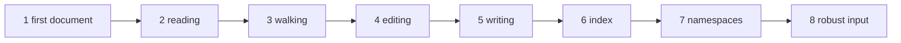

# The tutorial

The tutorial teaches FoXy by building one program, step by step. The [cookbook](./cookbook) then collects short recipes
for everyday tasks, and the [reference](/guide/features#feature-map) has every method and every argument.

## The chapters

The tutorial builds `solver`, the input and output of a (pretend) flow solver: it reads its case file, checks and edits
it, writes its results and reads them back. Each chapter is a complete program that you can compile and run; every
output shown is the real output of that program.

| Chapter | You learn |
|---|---|
| [1. A first document](./tutorial/01-first-document) | `xml_file`, `parse`, `content`, `find`, `attribute`, `stringify`; tag IDs |
| [2. Reading the case file](./tutorial/02-reading) | `parse(filename=)`, paths, typed values (`get_content`, `get_attribute`), errors |
| [3. Walking the tree](./tutorial/03-walking) | `children`, `name`, `attributes_number`, `attribute_name`, `find_all`, `tags_number` |
| [4. Editing and saving](./tutorial/04-editing) | `set_content`, `set_attribute`, `delete_attribute`, `delete_tag`, `add_tag`, `save` |
| [5. Writing the results](./tutorial/05-writing) | `xml_writer`: `open`, `start`, `attribute`, `text`, `raw`, `end`, `close` |
| [6. Large outputs: the index](./tutorial/06-index) | `xml_index`: `scan`, content on demand, byte ranges, `stop_at` |
| [7. Namespaces](./tutorial/07-namespaces) | `prefix`, `local_name`, `namespace`, `{uri}local`, `namespaces=` |
| [8. Robust input and text](./tutorial/08-robust) | malformed input, tolerant parsing, references, CDATA, mixed content, `xml_escape` |



## The cookbook

[The cookbook](./cookbook) answers "how do I ...?" in a few lines each: read a number from a tag, loop over repeated
tags, change a value and save, write a large file, read only what you need of a huge one, ...

## Building the examples

Every program of the tutorial and of the cookbook is in [`docs/examples/src`](https://github.com/Fortran-FOSS-Programmers/FoXy/tree/master/docs/examples/src),
their input files in [`docs/examples/files`](https://github.com/Fortran-FOSS-Programmers/FoXy/tree/master/docs/examples/files).
With FoXy built by FoBiS (`fobis build --mode foxy-static-gnu`, see [Installation](/guide/installation)):

```bash
gfortran -I lib/mod docs/examples/src/solver_1.f90 lib/libfoxy.a -o solver
./solver
```

`bash scripts/docs_examples.sh` builds and runs all of them, regenerating the outputs shown in these pages. The programs
that read a file expect the ones of `docs/examples/files` in the current directory.
