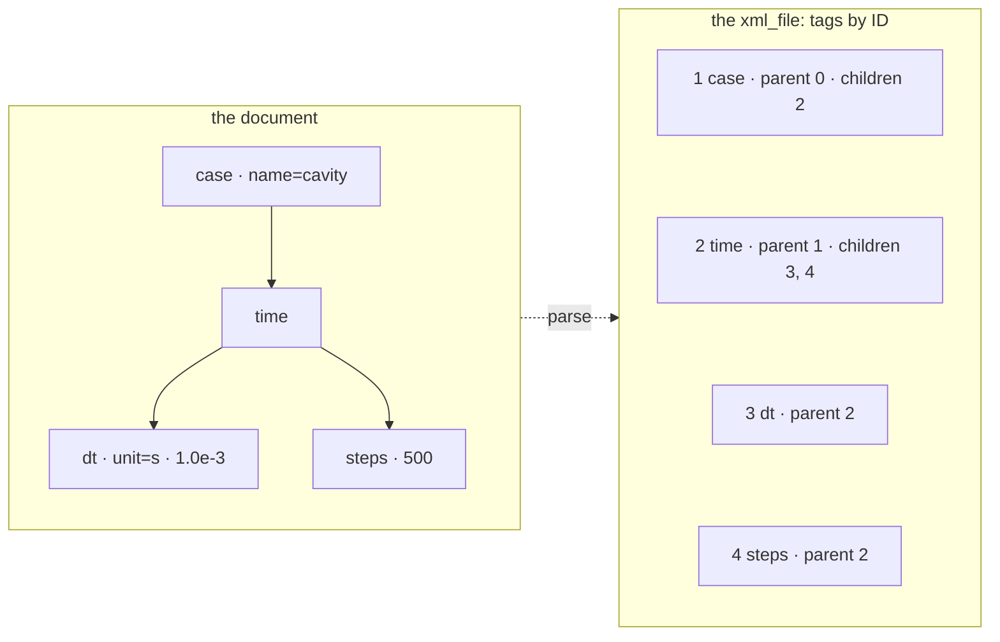

# 1. A first document

`solver` starts from its case: a small XML document, parsed from a string into an `xml_file`.

<<< @/examples/snippets/solver_1.f90

- `use foxy` gives everything: the types (`xml_file`, `xml_index`, `xml_handler`, `xml_writer`, `xml_tag`), the kinds
  (`I4P`, `R8P`, ...), the error codes, `xml_escape`/`xml_unescape`, `to_value`/`to_values` and StringiFor's `regex`.
- `parse` reads the whole source into a DOM: a flat array of tags, numbered `1`, `2`, ... in document order. A tag is
  known by its **ID**, its index in that array; `0` means "no tag" (and, for `children` and `parent=`, the document
  itself, whose children are the root tags). Each tag knows its parent and its children:

- `content(name)` returns the text of the first tag with that name, `content(id=)` the text of a given tag: blanks
  around it removed, character references decoded.
- `find` returns the ID of the first tag matching a `name`, a `/`-separated `path` (the first name anywhere, each next
  one a child of the previous), or a name among the children of `parent`.
- `attribute(id, name)` returns the value of an attribute, `''` if the tag has none.
- `stringify` writes the document back, laid out.

## Running it

<<< @/examples/output/solver_1.ansi{ansi}

::: tip What you learned
A document is a flat array of tags known by their IDs; `find` gives IDs, `content` and `attribute` read text. Reference:
[Querying](/guide/querying).
:::

Next: [2. Reading the case file](./02-reading).
