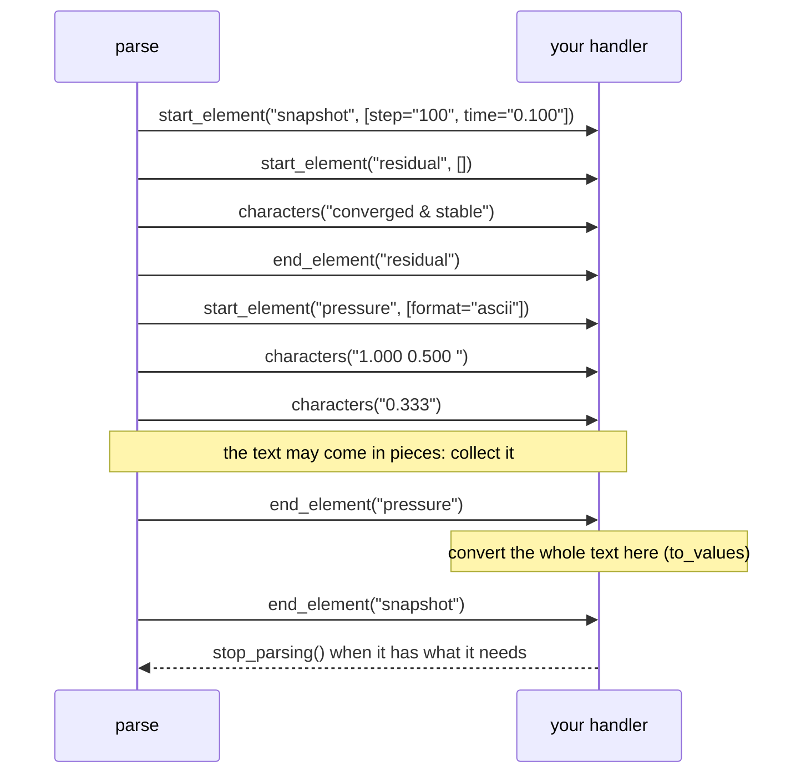

# 7. Your own handler

The index of [chapter 6](./06-index) keeps the tags of a file and reads contents on demand. For a statistic over every
snapshot, `solver` needs neither: it reads `results.xml` once, from the start to the end, with a handler of its own that
the streaming parser calls for each element.

<<< @/examples/snippets/solver_7.f90

- A handler is a type that extends `xml_handler` and overrides the callbacks it needs: here `start_element`,
  `characters` and `end_element`. The others (comments, PIs, problems, ...) do nothing by default.
- The callbacks are ordinary procedures: they print, and keep their state (the current step, the text being collected)
  in the type.
- `start_element` gets the attributes of the element, decoded: the step of each snapshot is read from there, with
  `to_value` (the conversion of `get_attribute`, for any text you hold).
- The handler also knows where it is: `level` is the depth of the current element (1 for the root), `pos` the byte of
  the event in the source.
- `characters` may get the text of an element in pieces (a long data array comes in many): collect it and convert it in
  `end_element`, here with `to_values`, the conversion of `get_content`.
- `parse` reads the file in chunks and calls the callbacks in source order; `stop_parsing` ends the parse early, and the
  rest of the file is not read.

For one snapshot, the calls are:

## Running it

<<< @/examples/output/solver_7.ansi{ansi}

::: tip What you learned
Extend `xml_handler`, override the callbacks you need, `parse` once: any file size, your own state. Reference:
[Streaming parser](/guide/events).
:::

Next: [8. Namespaces](./08-namespaces).
